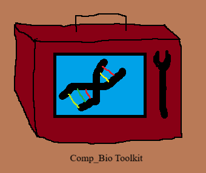

# Computational Biology

[](License.md)


A collection of Python scripts and notebooks for evolutionary and comparative genomics, written alongside my MSc in Genomic Science and since extended through self-directed projects. The work centres on how genome organisation relates to genome evolution, from sequence composition and replication-associated structure to 3D chromosome folding. It also covers transcriptomics, metagenomics, regulatory network inference and a few machine-learning exercises.

Most scripts are standalone and take their inputs from the command line or from a configuration block at the top of the file. They are not a packaged library. Several were developed on small example data (see `resources/`), and each status entry below says how far a tool has been tested.



---

## Featured Project: `hic3d-demo`

[`hic3d-demo/`](hic3d-demo) is a computational framework for simulating 3D genome organisation, generating synthetic Hi-C contact maps, and evaluating computational methods for chromatin architecture analysis against known ground truth.

### Implemented Capabilities

- **Genome simulation:** Generates synthetic genomes comprising 600 genomic bins, with configurable TADs, A/B compartments, inversions and segment swaps.
- **TAD boundary detection:** Identifies chromatin domain boundaries using insulation-score analysis.
- **Compartment identification:** Detects A/B compartments using PC1 derived from the observed/expected contact correlation matrix.
- **Rearrangement detection:** Identifies candidate chromosomal rearrangement breakpoints through change-point analysis of long-range contact profiles.
- **3D genome reconstruction:** Reconstructs spatial genome organisation from shortest-path contact-derived distances using classical multidimensional scaling (MDS), following the general approach of ShRec3D.
- **Breakpoint enrichment analysis:** Uses permutation testing to evaluate the spatial association between chromosomal rearrangement breakpoints and TAD boundaries. The analysis can also be applied to user-supplied breakpoint and boundary coordinates.

### Benchmarking Results

Performance was evaluated across 20 independently simulated genomes.

| Analysis | Evaluation Metric | Result |
|---|---|---:|
| TAD boundary detection | F1-score (2-bin tolerance) | 0.94 |
| A/B compartment identification | Accuracy | 0.96 |
| 3D genome reconstruction | Spearman correlation of true and reconstructed distances | 0.88 |
| Rearrangement breakpoint detection | Precision (3-bin tolerance) | 0.44 |
| Rearrangement breakpoint detection | Recall (3-bin tolerance) | 0.57 |
| Enrichment test with random breakpoints | Median p-value; significant simulations | 0.46; 0/20 |
| Enrichment test with boundary-associated breakpoints | Median p-value; significant simulations | 0.0005; 20/20 |

### Scope and Limitations

All benchmark data are synthetically generated. The framework provides a controlled environment for evaluating chromatin architecture analyses, 3D reconstruction and breakpoint-enrichment methods against known genomic structures. Its results should not be interpreted as evidence of performance on experimental Hi-C datasets or biological genomes.

In particular, breakpoint detection from contact profiles remains challenging when rearrangement junctions resemble chromatin domain boundaries. Further methodological details and limitations are documented in [`hic3d-demo/README.md`](hic3d-demo/README.md).

### Running the Workflow

```bash
cd hic3d-demo

pip install -r requirements.txt

python hic3d_demo.py run --seed 1 --outdir results

python -m pytest -q tests
```

---

## Repository layout

```
Computational_Biology/
├── hic3d-demo/        Hi-C simulation and 3D reconstruction (own README, tests, results)
├── src/               Analysis scripts and notebooks
├── Conservation/      Structural variant, genetic load and pangenome scripts
├── resources/         Small example inputs (FASTA, expression tables, a RAxML tree)
├── logo/
├── requirements.txt
└── License.md
```

---

## Tools in `src/`

### Sequence analysis and genome organisation

| Script | Function | Status |
|---|---|---|
| `codon_analysis.py` | Codon usage profiling | Complete |
| `dna-protein.py` | Six-frame DNA translation | Complete |
| `gc_skew_calc.py` | Cumulative GC skew for archaeal genomes | Complete |
| `gc_calc_pwa.py` | Comparative GC analysis | Complete |
| `promoter_id.py` | Promoter and motif scanning | Complete |
| `protein_property.py` | Amino acid property analysis | Complete |
| `protein_seq_motif.py` | Protein motif detection | Complete |
| `seq_align_score_calc.py` | Needleman-Wunsch and Smith-Waterman alignment scoring | Complete |

### Comparative and evolutionary genomics

| Script | Function | Status |
|---|---|---|
| `phylogenetic_analysis.py` | Distance-based tree construction | Complete |
| `gen_red_inf.py` | Genome reduction analysis across Asgard, DPANN and other archaeal genomes (coding density, ATP synthase genes, composition, PCA) | Under revision: the bundled `resources/genome_reduction_results.csv` contains implausible genome sizes and gene counts and must be regenerated before use |
| `variant_annotation.py` | Variant functional annotation | Complete |
| `mutation_anotation.py` | Mutation annotation | Complete |
| `somatic_variation.py` | Comparative genome analysis | Complete |

### Transcriptomics and regulatory networks

| Script | Function | Status |
|---|---|---|
| `rna_analysis.py` | Bulk RNA-seq processing and visualisation | Complete |
| `scrna.ipynb` | Single-cell RNA-seq analysis | Complete |
| `panda_lioness.ipynb` | PANDA and LIONESS network inference on TCGA ovarian cancer data | In progress |
| `adhesion_metabolism_crosstalk.py` | Pathway interaction analysis | Complete |

### Metagenomics and machine learning

| Script | Function | Status |
|---|---|---|
| `metagenomic.py` | Taxonomic and functional profiling | Complete |
| `ampml.ipynb` | Multi-label classification of antimicrobial proteins | Complete |

### Viral population graphs

| Script | Function | Status |
|---|---|---|
| `seqgraph.py` | Variation graph construction and analysis | Prototype, tested on simulated data |

## Tools in `Conservation/`

| Script | Function | Status |
|---|---|---|
| `sv_annotation.py` | Structural variant calling with Sniffles and annotation | Needs a BAM file as input |
| `genetic_load.py` | Genetic load metrics from a variant table | Needs a tab-separated variant table |
| `pangenome_assembly.py` | Pangenome construction with minigraph | Assembly paths are set in the configuration block at the top of the file |

---

## seqgraph: variation graphs for viral populations

`src/seqgraph.py` is a single Python file with no third-party dependencies. It turns an alignment of viral haplotypes into a variation graph and analyses it. FASTA headers can carry a sample label and an abundance (`>hap1 sample=S01 count=37`), so a quasispecies can be described per sample.

```bash
# simulate a dataset with planted truth, build the graph, and benchmark
python src/seqgraph.py demo --out seqgraph_demo/demo

# analyse your own alignment
python src/seqgraph.py build aln.fasta --out run/x --genes genes.tsv --meta meta.tsv

# check that the GFA spells every input sequence
python src/seqgraph.py check run/x.gfa aln.fasta

# run the unit tests
python src/seqgraph.py test
```

Inputs are an aligned FASTA with equal-length records (the first record is the reference unless `--ref` is given), an optional genes table with `gene`, `start` and `end` in reference coordinates, and an optional metadata table whose first column is `sample`. Numeric metadata columns are analysed.

Outputs:

* `.gfa`: the graph in GFA 1.0, with one path per input haplotype
* `.bubbles.tsv`: variant sites with alleles, entropy, gene and codon impact
* `.samples.tsv`: per-sample haplotype entropy and diversity
* `.assoc.tsv`: rank correlations with metadata, with Benjamini-Hochberg q-values
* `.html`: an interactive viewer with the graph, a site-entropy track and a gene track

Status and limitations:

* On the simulated demo data it recovers all 6 planted mutational hotspots and ranks the planted SNP-metadata association second of 83 allele tests. It has not yet been run on real data.
* Compatibility of the exported GFA with vg and odgi has not been tested.
* Variants in the first or last alignment column are not reported.
* It is pure Python and suits alignments of up to a few thousand columns and haplotypes.

---

## Installation

```bash
git clone https://github.com/Aridoge13/Computational_Biology.git
cd Computational_Biology
pip install biopython matplotlib seaborn pandas numpy scipy scikit-learn pysam adjustText 'scanpy[leiden]'
```

The `[leiden]` extra installs `igraph` and `leiden`, which scanpy needs for clustering. Some modules need extra tools:

```bash
pip install sniffles               # structural variant calling (Conservation/sv_annotation.py)
pip install netzoopy pyarrow       # PANDA and LIONESS (src/panda_lioness.ipynb)
git clone https://github.com/lh3/minigraph && cd minigraph && make   # pangenome construction
```

`seqgraph.py` and `hic3d-demo` have their own requirements (the standard library for the first; NumPy, SciPy and Matplotlib for the second). The top-level `requirements.txt` is a full environment snapshot, not a minimal dependency list.

Scripts that query NCBI through Biopython (for example `gen_red_inf.py`) read the contact address from `Entrez.email` near the top of the file. Set it to your own address before running.

---

## Contributing and licence

Issues and pull requests are welcome. The code is distributed under the [MIT License](License.md).