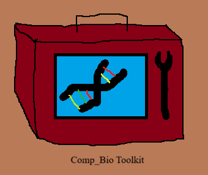
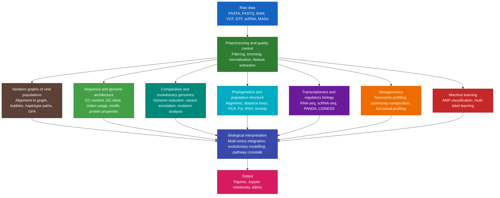

# Computational Biology Toolkit for Genomic Analysis

[](License.md)




## Overview

This repository is a collection of Python scripts and notebooks for evolutionary and comparative genomics. I started it alongside my MSc in Genomic Science and have extended it since through self-directed projects. The central question is how genome organisation relates to genome evolution, studied through sequence composition and replication-associated structure. The repository also holds work on transcriptomics, metagenomics, regulatory network inference, population and conservation genomics, and a few machine-learning exercises.

Every tool reads standard bioinformatics formats and runs on its own. Some tools feed into each other, as the workflow diagram below shows.

**Contents**

* [Functional areas](#functional-areas)
* [Repository layout](#repository-layout)
* [Workflow integration](#workflow-integration)
* [Available scripts](#available-scripts)
* [Population and conservation genomics](#population-and-conservation-genomics)
* [seqgraph: variation graphs for viral populations](#seqgraph-variation-graphs-for-viral-populations)
* [Installation](#installation)

---

## Functional areas

### Sequence analysis and genome architecture

* GC content and cumulative GC skew analysis
* Codon usage profiling and compositional analysis
* DNA translation and protein sequence analysis
* Protein motif detection and amino acid property analysis
* Promoter and regulatory motif scanning
* Pairwise alignment scoring (Needleman-Wunsch and Smith-Waterman)

### Comparative and evolutionary genomics

* Comparative genome analysis and mutation annotation
* Genome reduction and streamlining inference
* Phylogenetic tree construction and evolutionary distance analysis
* Population structure and divergence analysis
* Comparative microbial and archaeal genomics
* Replication-associated genome organisation

### Population and conservation genomics

* SNP quality control, LD pruning and PCA
* Pairwise Fst, heterozygosity and the inbreeding coefficient
* Runs of homozygosity (ROH) and F_ROH
* Pairwise kinship (KING-robust)
* ADMIXTURE wrapper for ancestry proportions
* Pangenome graph construction and structural variant calling
* Genetic load scoring from annotated variants

### Transcriptomics and regulatory systems biology

* Bulk RNA-seq analysis and expression visualisation
* Single-cell RNA-seq workflows
* Differential expression and pathway enrichment
* Gene regulatory network inference with PANDA and LIONESS
* Patient-specific network modelling on TCGA datasets
* Pathway interaction and crosstalk analysis

### Metagenomics and multi-omics

* Taxonomic and functional metagenomic profiling
* Community-level sequence analysis
* Multi-omics data integration

### Graph-based analysis of viral populations

* Variation graph construction from a multiple sequence alignment of viral haplotypes
* Bubble detection to identify variant sites, with allele frequencies and entropy per site
* Heaviest path (consensus), k-best paths, and counts of the haplotype space the graph allows
* Mutational hotspot windows and codon-level impact of SNPs in annotated genes
* Sample-level diversity and rank correlation of allele frequencies with numeric metadata
* GFA 1.0 export and an interactive HTML viewer

### Machine learning

* Multi-label classification of antimicrobial proteins
* Feature engineering for high-dimensional omics data

---

## Repository layout

| Path | Contents |
|------|----------|
| `src/` | Scripts and notebooks for sequence analysis, comparative genomics, transcriptomics, metagenomics, machine learning and `seqgraph.py` |
| `Conservation/` | Population and conservation genomics scripts: SNP analysis, pangenome graphs, structural variants and genetic load |
| `resources/` | Small example inputs (FASTA, expression tables, trees) and a genome reduction results table |
| `logo/` | Repository logo |

---

## Workflow integration

Tools can run independently or as components of a larger analysis.



---

## Available scripts

### `src/`

| Script | Function | Status |
|--------|----------|--------|
| `codon_analysis.py` | Codon usage analysis | Completed |
| `dna-protein.py` | Six-frame DNA translation | Completed |
| `gc_skew_calc.py` | Archaeal GC skew analysis | Completed |
| `gc_calc_pwa.py` | Comparative GC analysis | Completed |
| `phylogenetic_analysis.py` | Distance-based tree construction | Completed |
| `promoter_id.py` | Promoter and motif scanning | Completed |
| `protein_property.py` | Amino acid property analysis | Completed |
| `protein_seq_motif.py` | Protein motif detection | Completed |
| `rna_analysis.py` | RNA-seq processing and visualisation | Completed |
| `seq_align_score_calc.py` | Alignment scoring (Needleman-Wunsch and Smith-Waterman) | Completed |
| `variant_annotation.py` | Variant functional annotation | Completed |
| `mutation_anotation.py` | Mutation annotation | Completed |
| `metagenomic.py` | Metagenomic profiling | Completed |
| `adhesion_metabolism_crosstalk.py` | Pathway interaction analysis | Completed |
| `somatic_variation.py` | Comparative genome analysis | Completed |
| `gen_red_inf.py` | Comparative genome reduction pipeline | Completed |
| `scrna.ipynb` | Single-cell RNA-seq analysis | Completed |
| `ampml.ipynb` | Multi-label classification of antimicrobial proteins | Completed |
| `panda_lioness.ipynb` | Gene regulatory network analysis | Currently being run on Google Cloud Platform |
| `seqgraph.py` | Variation graphs for viral populations | Prototype, tested on simulated data |

### `Conservation/`

| Script | Function | Status |
|--------|----------|--------|
| `snp_population_analysis.py` | SNP QC, PCA, Fst, diversity, ROH, kinship and optional ADMIXTURE from a multi-sample VCF | Tested on a synthetic VCF; real-data run in progress |
| `pangenome_assembly.py` | Pangenome graph construction with minigraph and structural variant counts from the GFA | Script complete; no real-data results in the repository yet |
| `sv_annotation.py` | Structural variant calling with Sniffles from a BAM file and annotation against a GFF | Script complete; no real-data results in the repository yet |
| `genetic_load.py` | Genetic load scoring from annotated variants, with a built-in example dataset | Script complete; no real-data results in the repository yet |

---

## Population and conservation genomics

### `snp_population_analysis.py`

This script analyses a multi-sample SNP VCF, such as one produced by calling variants on public sequencing runs from NCBI SRA. It writes tables and figures for each analysis into one output directory, together with a QC table that records how many variants remain after every filter and a `run_parameters.json` file with every setting used.

```bash
python Conservation/snp_population_analysis.py \
    --vcf cohort.snps.vcf.gz \
    --metadata SraRunTable.csv --sample-col Run --pop-col breed \
    --chroms <autosome accessions> \
    --out results/ \
    --admixture-k 2 6 --threads 8
```

**Inputs**

* A VCF of SNPs called against a single reference assembly. Sample names must match the metadata file.
* A metadata table (TSV or CSV) with one sample column and one population column. An NCBI SRA Run Selector export works directly.

**Analyses**

* QC: biallelic SNPs, optional QUAL filter, per-sample and per-site missingness, minor allele frequency, and removal of sex, mitochondrial and unplaced contigs
* PCA on LD-pruned SNPs with Patterson scaling
* Pairwise Hudson Fst with block-jackknife standard errors
* Observed and expected heterozygosity and the inbreeding coefficient per population
* ROH from a two-state hidden Markov model solved with the Viterbi algorithm, with ROH length classes and F_ROH per sample
* KING-robust pairwise kinship, with related pairs listed by inferred degree
* ADMIXTURE (optional): PLINK files are written from the pruned SNPs, the external `admixture` program runs over a range of K with cross-validation, and ancestry bar plots are drawn

**Outputs**

* `qc_summary.tsv`, `sample_summary.tsv` and `run_parameters.json`
* `pca_coordinates.tsv` and `pca.png`
* `fst_matrix.tsv`, `fst_pairs.tsv` and `fst_heatmap.png`
* `diversity_by_population.tsv`
* `roh_segments.tsv`, `roh_summary.tsv` and `roh.png`
* `kinship_king_matrix.tsv`, `kinship_related_pairs.tsv` and `kinship_heatmap.png`
* `admixture_cv_error.tsv`, `admixture_K*_ancestry.tsv` and `admixture.png` (only with `--admixture-k`)

**Status and limitations**
* NCBI reference contigs are accessions, so pass the autosomes with `--chroms`.
* ROH are called on variant sites only. Absolute F_ROH values depend on SNP density and on the MAF filter, so compare samples within one run.
* KING-robust kinship assumes limited population structure. Run it within a single breed or population.
* Genotypes are held in memory as 8-bit integers. A VCF of 10 million SNPs and 100 samples needs about 1 GB.

### Pangenomes, structural variants and genetic load

* `pangenome_assembly.py` runs minigraph on a reference and a set of assemblies, then parses the GFA for structural variant counts. The input paths are constants at the top of the file.
* `sv_annotation.py` calls structural variants with Sniffles from a long-read BAM file and annotates them against a GFF. Usage: `python Conservation/sv_annotation.py --bam_file reads.bam --gff_file genes.gff`.
* `genetic_load.py` scores variants by predicted consequence and allele frequency, and compares load between populations. Run it with the example-data option to see the expected input format.

---

## seqgraph: variation graphs for viral populations

`src/seqgraph.py` is a single Python file with no third-party dependencies. It turns an alignment of viral haplotypes into a variation graph and analyses it. Headers can carry a sample label and an abundance (`>hap1 sample=S01 count=37`), so a quasispecies can be described per sample.

### Quick start

```bash
# simulate a dataset with planted truth, build the graph, and benchmark
python seqgraph.py demo --out seqgraph_demo/demo

# analyse your own alignment
python seqgraph.py build aln.fasta --out run/x --genes genes.tsv --meta meta.tsv

# check that the GFA spells every input sequence
python seqgraph.py check run/x.gfa aln.fasta

# run the unit tests
python seqgraph.py test
```

### Inputs

* Aligned FASTA with equal-length records. The first record is the reference unless `--ref` is given.
* Optional genes TSV with `gene`, `start` and `end` in reference coordinates.
* Optional metadata TSV with `sample` as the first column. Numeric columns are analysed.

### Outputs

* `.gfa`: the graph in GFA 1.0, with one path per input haplotype
* `.bubbles.tsv`: variant sites with alleles, entropy, gene and codon impact
* `.samples.tsv`: per-sample haplotype entropy and diversity
* `.assoc.tsv`: rank correlations with metadata, with Benjamini-Hochberg q-values
* `.html`: an interactive viewer with the graph, a site-entropy track and a gene track

### Status and limitations

* On the simulated demo data it recovers all 6 planted mutational hotspots and ranks the planted SNP-metadata association second of 83 allele tests. It has not yet been run on real data.
* Compatibility of the exported GFA with vg and odgi has not been tested yet.
* Variants in the first or last alignment column are not reported.
* Metadata analysis uses numeric columns only.
* It is pure Python and suits alignments of up to a few thousand columns and haplotypes.

---

## Installation

### Requirements

* Python 3.9 or later
* Biopython
* NumPy, pandas and Matplotlib

### Setup

```bash
git clone https://github.com/Aridoge13/Computational_Biology.git
cd Computational_Biology

pip install biopython matplotlib seaborn pandas numpy pysam 'scanpy[leiden]'
```

The `[leiden]` extra installs `igraph` (Csardi and Nepusz, 2006) and `leiden` (Traag et al., 2019). Scanpy uses them for clustering but does not require them.

### Tools for specific modules

```bash
# SNP population analysis (Conservation/snp_population_analysis.py)
pip install scikit-allel numba
# ADMIXTURE is a separate program: https://dalexander.github.io/admixture/

# Structural variant calling (Conservation/sv_annotation.py)
pip install sniffles

# Gene regulatory network analysis (panda_lioness.ipynb)
pip install netzoopy pyarrow

# Pangenome construction (Conservation/pangenome_assembly.py)
git clone https://github.com/lh3/minigraph
cd minigraph && make
```

* `src/seqgraph.py` needs only the Python standard library. Run `python src/seqgraph.py test` to check it.
* The top-level `requirements.txt` is a full snapshot of my working environment. It lists far more packages than any single script needs.
* Scripts that query NCBI through Biopython, such as `gen_red_inf.py`, read the contact address from `Entrez.email` near the top of the file. Set it to your own address before running.

---

## Design principles

* **Modularity:** components can be reused in custom workflows
* **Reproducibility:** deterministic outputs with documented dependencies and recorded parameters
* **Clarity:** readable implementations suitable for learning and extension
* **Honest status:** each script is labelled with what has and has not been tested

## Contribution

Issues, feature requests and pull requests are welcome.

## License

Distributed under the [MIT License](License.md).