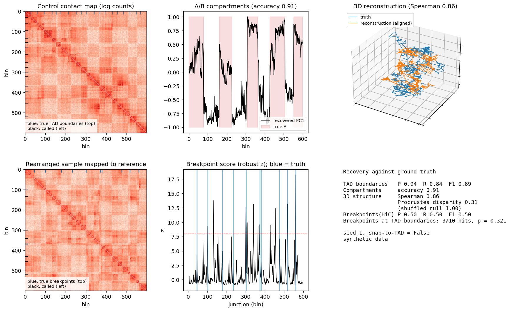

# hic3d-demo

A small, self-contained pipeline that simulates a 3D genome, turns it into Hi-C contact counts,
and tries to recover the structure again. Because the truth is known at every step, each
analysis is scored instead of eyeballed.

This is a learning and demonstration project on synthetic data. It shows how the standard Hi-C
analyses work and how well they perform under controlled conditions. It makes no claims about
real genomes.



## What it does

1. **Simulates a reference genome** of 600 bins made of TADs (compact domains of 20 to 40 bins)
   and alternating A/B compartment blocks.
2. **Simulates a 3D conformation** (each TAD is a compact blob, blobs are linked in a confined
   walk) and converts pairwise distances into Poisson contact counts with expectation
   proportional to 1/distance, modulated by compartment type.
3. **Introduces rearrangements** (inversions and a segment swap) in the sampled genome and maps
   its reads back to the reference order, which gives the off-diagonal signatures that
   structural variants leave in Hi-C maps.
4. **Recovers structure**:
   - TAD boundaries from the insulation score
   - A/B compartments from PC1 of the correlation matrix of the observed/expected map
   - rearrangement breakpoints from change points in long-range contact profiles
   - the 3D structure from shortest-path distances on the contact graph followed by classical
     MDS (in the spirit of ShRec3D, Lesne et al. 2014)
5. **Tests breakpoint enrichment at TAD boundaries** with a permutation test, using known
   breakpoints as a stand-in for independent calls such as synteny breaks.

## Usage

```bash
pip install -r requirements.txt
python hic3d_demo.py run --seed 1 --outdir results          # one dataset, metrics and figure
python hic3d_demo.py run --seed 1 --snap                    # breakpoints placed on TAD boundaries
python hic3d_demo.py benchmark --seeds 20                   # many datasets, both placements
python hic3d_demo.py enrich --breakpoints bp.txt --boundaries tads.txt --n-bins 600
python -m pytest -q tests
```

The `enrich` command works on your own data: two text files with one bin index per line.

## Results (20 simulated genomes, seeds 0 to 19)

| Analysis | Result |
|---|---|
| TAD boundaries (tolerance 2 bins) | F1 0.94 |
| A/B compartments | accuracy 0.96 |
| 3D reconstruction | Spearman 0.88 between true and reconstructed distances |
| Breakpoints from Hi-C alone (tolerance 3 bins) | precision 0.44, recall 0.57 |
| Enrichment test, random breakpoints | median p = 0.46, 0 of 20 genomes with p < 0.05 |
| Enrichment test, breakpoints on TAD boundaries | median p = 0.0005, 20 of 20 genomes with p < 0.05 |

Full numbers are in `results/benchmark.json`.

## Limitations

- **Breakpoint calling from Hi-C alone is only moderate.** In the simulation, neighbouring TADs
  are separate blobs with different long-range partners, so a TAD boundary looks a lot like a
  rearrangement junction to a change-point score. In a check on 8 seeds, 33 of 37 false positives (about 9 in 10) sat on
  or next to TAD boundaries. This is also why the enrichment test is run on independently known
  breakpoints: running it on Hi-C-called breakpoints would inherit that bias and inflate the
  result. Real structural-variant callers use more specific signatures and a reference
  conformation.
- **Compartment recovery depends on compartment strength.** At a contact modulation of 0.2 the
  accuracy falls to about 0.67, and at 0.35 or higher it is close to 1.0. The default is 0.3.
- **Everything is synthetic.** The contact model (expectation proportional to 1/distance,
  Poisson noise, blob-shaped TADs) is a simplification. There is no loop extrusion, no real
  chromatin polymer physics and no experimental biases such as GC content or mappability.
- **Parameters were tuned on a few seeds** (100 to 107, and an early look at 0 to 7), so the
  benchmark numbers are somewhat optimistic.
- Contact counts are not iteratively balanced because the simulation has no coverage bias.
  Real data needs normalisation (ICE or similar) first.

## Files

- `hic3d_demo.py`: the whole pipeline (simulation, analyses, scoring, CLI)
- `tests/test_hic3d.py`: unit tests, including a check that the enrichment test does not
  produce systematic false positives
- `results/`: example figure, single-run metrics and the benchmark
